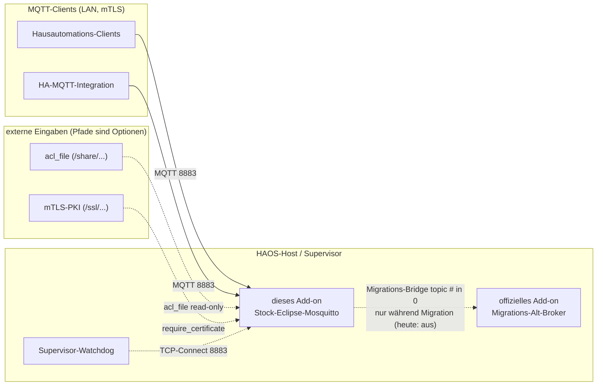

# Mosquitto Standalone — lokales Home-Assistant-Add-on mit wirksamer Datei-ACL

**Problem:** Das offizielle Mosquitto-Add-on von Home Assistant (≥ 7.0,
Mosquitto 2.1) setzt Datei-ACLs aus dem customize-Mechanismus
stillschweigend nicht mehr durch: sein go-auth-Plugin beantwortet
ACL-Prüfungen vor Mosquittos builtin-security-Plugin und erlaubt jedem
gültigen Login alles
([home-assistant/addons#4571](https://github.com/home-assistant/addons/issues/4571)).
Die ACL-Datei wird geladen — und ignoriert.

**Lösung:** Dieses Repository verpackt **Stock-Eclipse-Mosquitto** als
*lokales* Home-Assistant-Add-on. Kein go-auth: Authentifizierung läuft
ausschließlich über `password_file`, Autorisierung über `acl_file` —
beides greift wirklich. Das Add-on bleibt Supervisor-verwaltet (Backups,
Watchdog, Lebenszyklus), anders als ein roher Docker-Container, den HAOS
als „unsupported" einstuft.

> ## ⚠ Haftungsausschluss — Nutzung auf eigene Gefahr
>
> Dieses Projekt ersetzt ein Kernstück deiner Hausautomations-Infrastruktur:
> den MQTT-Broker. **Sei vorsichtig.** Teste im Parallelbetrieb, verifiziere
> gründlich vor dem Cutover und halte den Rollback-Pfad bereit. Der Ansatz
> hat bei *meiner* Installation funktioniert — er muss nicht zu deiner
> passen. Alles hier wird **ohne jede Garantie oder Gewährleistung**
> bereitgestellt (siehe [LICENSE](LICENSE)). Ich pflege das als geteilten
> Workaround mit sehr begrenzter Kapazität: keine Zusagen zu Support,
> Fixes oder zeitnahen Reaktionen auf Issues/PRs. Für Änderungen an deinem
> System bist du allein verantwortlich.

**Migration:** Das mitgelieferte Deploy-Script orchestriert einen
risikoarmen Umstieg: neuer Broker parallel auf einem Alternativ-Port,
vollständige Übernahme des Retained-Bestands per MQTT-Bridge,
Verifikation (inkl. empirischem ACL-Negativtest), dann Cutover mit
wenigen Sekunden Downtime — mit trivialem Rollback-Pfad.

## Nach Zielgruppe

Diese README bedient sechs Lenses — jede findet hier ihren Einstieg:

| Lens | Ich will wissen … | Einstieg |
| --- | --- | --- |
| **ANWENDER** | was es tut und wie ich es nutze | [Schnellstart](#schnellstart) |
| **TECHNIKER** | wie es funktioniert (Komponenten, Datenfluss, Topologie) | [Architektur](#architektur) |
| **PROGRAMMIERER** | Aufbau, Interna, Beiträge | [Migration-Guide §Design-Entscheidungen](docs/migration-guide.de.md) |
| **OPERATEUR** | Betrieb Schritt für Schritt + Automatisierung | [Schnellstart](#schnellstart) · [Migration-Guide](docs/migration-guide.de.md) |
| **ARCHITEKTUR** | tragende Entscheidung/Topologie | [Architektur](#architektur) · [Migration-Guide](docs/migration-guide.de.md) |
| **COMPLIANCE** | Standards, Secrets/PII, Nachweise | keine Secrets/PII in diesem Repo (sanitisierter Export, [MIT](LICENSE)) — mTLS/ACL-Design im [Migration-Guide](docs/migration-guide.de.md) |

Task-orientiert — „Ich möchte …":

| Ich möchte … | Dokument |
| --- | --- |
| den ACL-Bug und den Fix verstehen | Problem + Lösung oben |
| das Add-on in Minuten aufsetzen | [Schnellstart](#schnellstart) |
| die risikoarme Migration fahren | [Migration-Guide](docs/migration-guide.de.md) |
| die ACL-Wirkung nachweisen | [Schnellstart](#schnellstart) → `--verify-acl` |
| eine Add-on-Option nachschlagen | `mosquitto-standalone/config.yaml` (Schema) |

## Dokumentation

Der vollständige, nachbaubare Ablauf (Ansatz, Teststrategie,
Phasen-Migration, Stolperstein-Tabelle aus einem echten Deploy):

- **[docs/migration-guide.de.md](docs/migration-guide.de.md)** (Deutsch)
- **[docs/migration-guide.en.md](docs/migration-guide.en.md)** (English)

English version of this README: [README.md](README.md)

## Architektur

Topologie (Mermaid, versioniert — TECHNIKER-Lens; Trust-Zonen als `subgraph`,
Kanten mit Protokoll/Port). Ein Ein-Container-Add-on, daher steht das
Diagramm inline hier statt in einer eigenen `docs/ARCHITECTURE.md`:



Repo-Layout:

```text
mosquitto-standalone/   das Add-on (nach /addons/<dir> auf dem HAOS-Host)
├── config.yaml         Add-on-Manifest: Ports, Mappings, Optionen + Schema
├── Dockerfile          FROM eclipse-mosquitto:<pinned>-alpine + jq + run.sh
└── run.sh              generiert mosquitto.conf + password_file, exec't mosquitto
scripts/deploy.sh       Orchestrierung: Status / Install / Update / Cutover / Rollback
deploy.conf.example     Vorlage für .local/deploy.conf (gitignored)
.github/workflows/ci.yml  CI: shellcheck, gitleaks, trivy (Config), trivy-image
.shellcheckrc / .trivyignore  Linter-Regeln / begründete Scanner-Ausnahmen
```

## Schnellstart

Voraussetzungen: HAOS-Host mit SSH-Zugang (`ha`-CLI + `jq`, `/addons`
beschreibbar — das offizielle SSH-Add-on bringt alles mit) und eine
bestehende mTLS-PKI, falls `require_certificate` genutzt wird (Pfade sind
Add-on-Optionen).

```bash
cp deploy.conf.example .local/deploy.conf   # dann anpassen
./scripts/deploy.sh                          # Status beider Add-ons
./scripts/deploy.sh --install --with-bridge --apply  # Migration: bauen +
                                             # parallel auf :18883, Bridge armiert
./scripts/deploy.sh --install --apply        # Re-Run/Repair OHNE Bridge
./scripts/deploy.sh --update --apply         # neue Add-on-Version ausrollen
./scripts/deploy.sh --cutover                # Cutover-Plan ansehen
./scripts/deploy.sh --cutover --apply        # Produktionsport übernehmen
./scripts/deploy.sh --rollback --apply       # zurück zum offiziellen Add-on
./scripts/deploy.sh --verify-acl             # ACL-Enforcement-Nachweis
```

Jede Phase ist ohne `--apply` ein Dry-Run. **Install** ist gefahrlos:
der neue Broker läuft parallel, der alte bleibt unberührt, Logins werden
serverseitig per Supervisor-API übernommen (Passwörter verlassen den Host
nie). Die Migrations-Bridge wird **nur** mit `--with-bridge` armiert
(fail-safe Default — ein Re-Run von `--install` kann keine Selbst-Bridge
scharfschalten). **Cutover** kostet ~10 Sekunden; Clients reconnecten von
selbst, weil Adresse und PKI gleich bleiben.

`--update` und `--cutover` enden fail-closed mit dem scriptbaren
ACL-Nachweis (`--verify-acl`): Positivtest (Login mit `read #` muss auf
`#` liefern) plus Negativtest (write-only-Login darf **nichts** liefern).
Die `ACL-VERIFY`-Zeile (UTC + Commit) ist der wiederkehrende Beleg — nach
jedem Broker-Update/-Neustart erneut fahren. Konfiguration:
`VERIFY_SSH`/`VERIFY_LOGIN`/`VERIFY_NEG_LOGIN`/`VERIFY_TLS_ARGS` in
`.local/deploy.conf`; `--no-verify` ist der explizite Notausstieg.

**Automatisierung (OPERATEUR-Lens):** Diese Deploys sind *bewusst manuell* —
Operator-getriggert, nie zeitgesteuert, weil sie einen Live-Broker berühren
(Separation of Duties). Einzig `--verify-acl` läuft automatisiert
(`Script (on-demand)`) als fail-closed Abschluss von `--update`/`--cutover`;
nach jedem Broker-Neustart erneut fahren.

## Status

Produktiv im Einsatz und auf HAOS verifiziert (2026): Der Retained-Bestand
wurde vollständig übernommen, alle Clients haben sich von selbst wieder
verbunden, und der ACL-Negativtest greift. Dazu gehört als Nachgang, dass
die HA-MQTT-Integration vom Superuser-Login auf einen
Least-Privilege-Login umgezogen ist (Migration-Guide, Phase 5). Wie
gemessen wurde und welche Stolpersteine dabei auftraten, steht im
Migration-Guide.

Seit v1.0.2/v1.0.3 ist das Add-on defensiv gehärtet: Optionswerte werden
vor der Config-Generierung sanitisiert und Dateipfade auf die gemappten
Volumes begrenzt, der Broker bekommt Ressourcengrenzen
(`max_connections`, `message_size_limit`, `max_queued_bytes`), das
Basis-Image ist auf einen Manifest-List-Digest gepinnt, die CI-Actions
sind auf Release-Tag-SHAs gepinnt, und die CI prüft sowohl die
Dockerfile-Konfiguration als auch das gebaute Image auf CVEs (Gate auf
CRITICAL).

v1.0.4 ergänzt fail-safe Defaults für die Migrations-Bridge:
`migration_bridge.enabled` steht ab Werk auf `false`, und `--install`
armiert sie nie implizit — für eine Migration braucht es bewusst
`--install --with-bridge`. Ebenfalls neu ist der wiederkehrende,
scriptbare ACL-Enforcement-Nachweis (`--verify-acl`), der als
verpflichtender, fail-closed Abschluss von `--update` und `--cutover`
verdrahtet ist.

v1.0.5 macht die TLS-Politik explizit, statt den Bibliotheks-Default zu
erben: Die generierte `mosquitto.conf` pinnt für TLS ≤ 1.2 eine
PFS-only-Cipher-Liste (ECDHE-Schlüsselaustausch, AES-GCM /
ChaCha20-Poly1305) und lässt damit die statischen RSA-Suiten ohne Perfect
Forward Secrecy fallen. TLS 1.3 bleibt aktiv, weil dessen Suiten
durchgängig PFS und AEAD bieten; `tls_version` wird bewusst **nicht**
gepinnt, da Mosquitto dann genau eine Version aushandeln würde und
`tlsv1.2` TLS 1.3 abschalten würde.

## Lizenz

[MIT](LICENSE)
