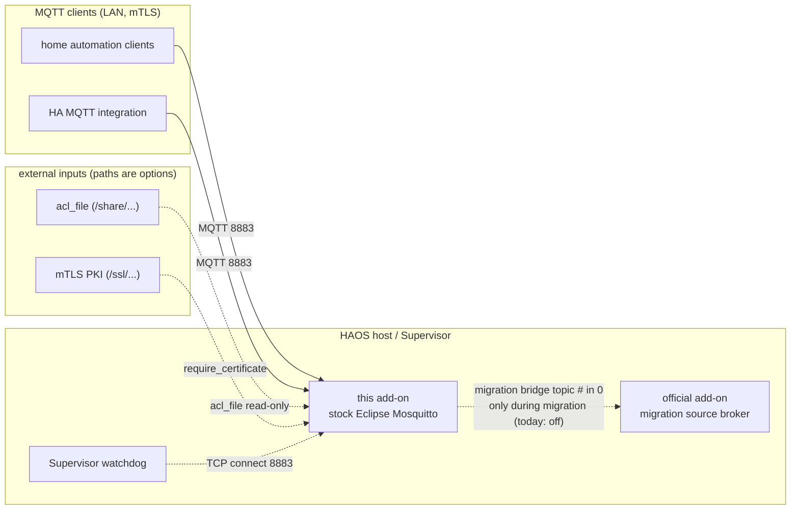

# Mosquitto Standalone — a local Home Assistant add-on with a working file ACL

**Problem:** Home Assistant's official Mosquitto add-on (≥ 7.0, Mosquitto 2.1)
silently stops enforcing file ACLs configured via the customize mechanism:
its go-auth plugin answers ACL checks before Mosquitto's builtin-security
plugin and allows everything for any valid login
([home-assistant/addons#4571](https://github.com/home-assistant/addons/issues/4571)).
The ACL file is loaded — and ignored.

**Solution:** this repository packages **stock Eclipse Mosquitto** as a
*local* Home Assistant add-on. No go-auth: authentication runs exclusively
via `password_file`, authorization via `acl_file` — both actually take
effect. The add-on stays Supervisor-managed (backups, watchdog, lifecycle),
unlike a raw Docker container, which HAOS marks as "unsupported".

> ## ⚠ Disclaimer — use at your own risk
>
> This project replaces a core piece of your home automation infrastructure:
> the MQTT broker. **Be careful.** Test in parallel operation, verify
> thoroughly before the cutover, and keep the rollback path available.
> This approach worked for *my* installation — it may not fit yours.
> Everything here is provided **as is, without any warranty or guarantee
> of any kind** (see [LICENSE](LICENSE)). I maintain this as a shared
> workaround with very limited capacity: no promises on support, fixes,
> or timely responses to issues or PRs. You alone are responsible for
> changes to your system.

**Migration:** the included deploy script orchestrates a low-risk switch:
run the new broker in parallel on an alternate port, mirror the complete
retained store via an MQTT bridge, verify (including an empirical ACL
negative test), then cut over with a few seconds of downtime — with a
trivial rollback path.

## By audience

This README serves six lenses — each has an entry point:

| Lens | I want to know … | Start here |
| --- | --- | --- |
| **USER** | what it does and how to use it | [Quick start](#quick-start) |
| **TECHNICIAN** | how it works (components, data flow, topology) | [Architecture](#architecture) |
| **DEVELOPER** | build, internals, how to contribute | [migration guide § design decisions](docs/migration-guide.en.md) |
| **OPERATOR** | operate step by step + automation | [Quick start](#quick-start) · [migration guide](docs/migration-guide.en.md) |
| **ARCHITECTURE** | the key decision / topology | [Architecture](#architecture) · [migration guide](docs/migration-guide.en.md) |
| **COMPLIANCE** | standards, secrets/PII, evidence | no secrets/PII in this repo (sanitized export, [MIT](LICENSE)) — the mTLS/ACL design lives in the [migration guide](docs/migration-guide.en.md) |

Task-oriented — "I want to …":

| I want to … | Document |
| --- | --- |
| understand the ACL bug and the fix | Problem + Solution above |
| set up the add-on in minutes | [Quick start](#quick-start) |
| run the low-risk migration | [migration guide](docs/migration-guide.en.md) |
| prove the ACL is enforced | [Quick start](#quick-start) → `--verify-acl` |
| look up an add-on option | `mosquitto-standalone/config.yaml` (schema) |

## Documentation

Start here — a full, reproducible walkthrough of the approach, the test
strategy, and the phased migration, including a pitfall table from a real
deployment:

- **[docs/migration-guide.en.md](docs/migration-guide.en.md)** (English)
- **[docs/migration-guide.de.md](docs/migration-guide.de.md)** (Deutsch)

Deutsche Kurzfassung dieses READMEs: [README.de.md](README.de.md)

## Architecture

Topology (Mermaid, versioned — TECHNICIAN lens; trust zones as `subgraph`,
edges labelled with protocol/port). A single-container add-on, so the
diagram lives inline here rather than in a separate `docs/ARCHITECTURE.md`:



Repository layout:

```text
mosquitto-standalone/   the add-on (copy to /addons/<dir> on the HAOS host)
├── config.yaml         add-on manifest: ports, mappings, options + schema
├── Dockerfile          FROM eclipse-mosquitto:<pinned>-alpine + jq + run.sh
└── run.sh              generates mosquitto.conf + password file, execs mosquitto
scripts/deploy.sh       orchestration: status / install / update / cutover / rollback
deploy.conf.example     template for .local/deploy.conf (gitignored)
.github/workflows/ci.yml  CI: shellcheck, gitleaks, trivy (config), trivy-image
.shellcheckrc / .trivyignore  linter rules / documented scanner exceptions
```

## Quick start

Prerequisites: HAOS host with SSH access (`ha` CLI + `jq`, `/addons`
writable — the official SSH add-on provides all of this), and an existing
mTLS PKI if you run `require_certificate` (paths are add-on options).

```bash
cp deploy.conf.example .local/deploy.conf   # then edit
./scripts/deploy.sh                          # status of both add-ons
./scripts/deploy.sh --install --with-bridge --apply  # migration: build + run
                                             # in parallel on :18883, bridge armed
./scripts/deploy.sh --install --apply        # re-run/repair WITHOUT the bridge
./scripts/deploy.sh --update --apply         # roll out a new add-on version
./scripts/deploy.sh --cutover                # review the cutover plan
./scripts/deploy.sh --cutover --apply        # take over the production port
./scripts/deploy.sh --rollback --apply       # back to the official add-on
./scripts/deploy.sh --verify-acl             # ACL enforcement proof (anytime)
```

Every phase is a dry run unless you add `--apply`. **Install** is
harmless: the new broker runs in parallel, the old one is untouched, and
logins are copied server-side via the Supervisor API (passwords never
leave the host). The migration bridge is armed **only** with
`--with-bridge` (and only while the old broker is actually running) — a
fail-safe default, so re-running `--install` on an existing installation
can never re-arm a self-bridge. **Cutover** costs ~10 seconds; clients
reconnect on their own because the address and PKI stay the same.

**Mandatory verification:** `--update` and `--cutover` end fail-closed
with a scriptable ACL enforcement proof (`--verify-acl`): a positive test
(a login with `read #` must receive messages on `#`) plus the negative
test (a write-only login must receive **nothing** — Mosquitto drops ACL
violations silently, so the passing positive test is what makes the empty
result meaningful). The printed `ACL-VERIFY` line (UTC + commit) is your
recurring evidence; re-run it after every broker update or restart.
Configure `VERIFY_SSH`, `VERIFY_LOGIN`, `VERIFY_NEG_LOGIN` and
`VERIFY_TLS_ARGS` in `.local/deploy.conf`; `--no-verify` is the explicit
escape hatch.

**Automation (OPERATOR lens):** these deploys are *deliberately manual* —
operator-triggered, never scheduled, because they touch a live broker
(separation of duties). The one automated piece is `--verify-acl`, wired
`Script (on-demand)` as the fail-closed conclusion of `--update`/`--cutover`;
re-run it after every broker restart.

## Status

Deployed and verified in production on HAOS (2026): complete retained
takeover, all clients reconnected, ACL negative test passing — including
the follow-up of moving the HA MQTT integration off the superuser login
onto a least-privilege login (guide, phase 5). See the migration guide
for the measurement methodology and pitfalls.

Since v1.0.2/v1.0.3 the add-on is defensively hardened: option values are
sanitized before config generation and file paths restricted to the
mapped volumes, the broker gets resource limits
(`max_connections`, `message_size_limit`, `max_queued_bytes`), the base
image is pinned to a manifest-list digest, CI actions are pinned to
release-tag SHAs, and CI scans both the Dockerfile configuration and the
built image for CVEs (gated on CRITICAL).

v1.0.4 adds fail-safe defaults for the migration bridge
(`migration_bridge.enabled` defaults to `false`; `--install` never arms
it implicitly — use `--install --with-bridge` for a migration) and the
recurring, scriptable ACL enforcement proof (`--verify-acl`, wired as the
mandatory fail-closed conclusion of `--update`/`--cutover`).

v1.0.5 makes the TLS policy explicit instead of inheriting the library
default: the generated `mosquitto.conf` pins a PFS-only cipher list for
TLS ≤ 1.2 (ECDHE key exchange, AES-GCM / ChaCha20-Poly1305), dropping the
non-PFS static-RSA suites. TLS 1.3 stays enabled (its suites are all
PFS + AEAD); `tls_version` is deliberately not pinned, since mosquitto
would then negotiate exactly one version and `tlsv1.2` would disable
TLS 1.3.

## License

[MIT](LICENSE)
